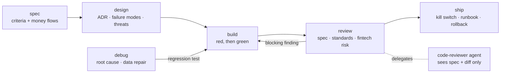

# Claude Fintech Skills

**IEEE-grounded software engineering and fintech-grade practices for Claude
Code, for building any software that handles money.**

This repository is a Claude Code plugin marketplace. Its plugin,
`fintech-software-engineer`, makes Claude work like a disciplined engineer on
fintech software: ledgers, payments, lending, brokerage and investment
platforms, digital assets, compliance tooling and financial analytics.

- **How it works:** a software-engineering workflow (spec → design →
  test-first build → independent review → ship) based on the IEEE Computer
  Society's *Guide to the Software Engineering Body of Knowledge*
  (SWEBOK v4.0a).
- **What it knows:** fintech rules for money, APIs, events, providers, audit
  and operations on every task, plus one-page rules for each financial domain,
  loaded only when the work touches that domain.
- **How it's enforced:** an independent reviewer agent for every change and a
  hook that catches floating point used for money.

It works in any language, with extra notes for .NET and Python.

---

## Contents

- [Why this exists](#why-this-exists)
- [Quick start](#quick-start)
- [Foundations](#foundations)
  - [IEEE SWEBOK v4](#ieee-swebok-v4)
  - [Fintech engineering practices](#fintech-engineering-practices)
- [The workflow](#the-workflow)
- [Domain packs](#domain-packs)
- [Guardrails](#guardrails)
- [Files the plugin creates in your project](#files-the-plugin-creates-in-your-project)
- [Testing and evaluation](#testing-and-evaluation)
- [Repository layout](#repository-layout)
- [Design choices](#design-choices)
- [Limitations](#limitations)
- [Contributing](#contributing)
- [Credits and licence](#credits-and-licence)

---

## Why this exists

General-purpose AI coding help is tuned for speed. Software that handles
money needs something else: traceable requirements, tests written before
code, explicit error handling, exact decimal arithmetic, idempotent
operations, append-only audit trails, reconciliation with every outside
party, and a second pair of eyes before anything is called done. The cost of
getting it wrong is not a broken page; it is a customer charged twice, a
ledger that doesn't balance, or a regulator asking questions.

This plugin encodes those disciplines as short, plain instructions Claude
follows by default, and enforces the most common money mistake in code.

## Quick start

Install from GitHub inside Claude Code:

```
/plugin marketplace add asjad99/claude-fintech-skills
/plugin install fintech-software-engineer@fintech-skills
```

Or try it for one session from a clone:

```bash
git clone https://github.com/asjad99/claude-fintech-skills.git
claude --plugin-dir ./claude-fintech-skills/plugins/fintech-software-engineer
```

For language diagnostics, also install Anthropic's `csharp-lsp` or
`pyright-lsp` plugins. The money-lint hook needs Python 3.

Then try:

| You type | What happens |
|---|---|
| `Add a transfer fee calculator` | `principles` and `build` load: a failing test first, decimal money, input contracts, full checks |
| `/fintech-software-engineer:spec recurring payments` | Clarifying questions on schedules, failures, consent and duplicates, then a spec with numbered acceptance criteria |
| `Customers are being credited twice` | `debug`: a reproducible failing check, root cause, regression test, data repaired with correcting entries |
| `/fintech-software-engineer:review` | The `code-reviewer` agent checks the diff against the spec, standards and the fintech rules for each domain it touches |
| `/fintech-software-engineer:ship` | Version, changelog, migrations, kill switch, runbook and rollback path, each evidenced |

---

## Foundations

### IEEE SWEBOK v4

The [SWEBOK Guide v4.0a](https://computer.org/swebok) (IEEE Computer Society)
organises generally accepted software-engineering knowledge into 18
knowledge areas. The plugin covers all 18 without creating 18 skills: areas
1-15 are practice and map to a workflow step; 16-18 are foundations the
model already has, so only the numeric rules that matter in finance are
written down.

| # | Knowledge area | What the agent does | Where |
|---|---|---|---|
| 1 | Requirements | User stories, numbered acceptance criteria, money flows, non-functional needs, traceability to tests | `spec` |
| 2 | Architecture | Records significant decisions with the concerns and options behind them | `design` |
| 3 | Design | Design principles, deep modules at clean seams, failure modes, design rationale | `design` |
| 4 | Construction | Simple, readable code; contracts at boundaries; explicit error handling; test-first | `build` |
| 5 | Testing | Tests at agreed seams, independent expected values, property, idempotency and invariant tests | `build`, `review` |
| 6 | Operations | Deployment, migrations, kill switches, runbooks, rollback, monitoring | `ship`, `debug` |
| 7 | Maintenance | Program comprehension and impact analysis before change; root-cause fixes | `debug`, `build` |
| 8 | Configuration Management | Version control, locked dependencies, reproducible builds, change trail | `ship`, `principles` |
| 9 | Engineering Management | Scope, risks, regulators and owners, out-of-scope list | `spec` |
| 10 | Process | The workflow itself | all skills |
| 11 | Models and Methods | State machines, sequence diagrams, domain glossary | `design` |
| 12 | Quality | Reviews, quality attributes, evidence of done | `review` |
| 13 | Security | Threat modelling (STRIDE), input validation, least privilege, secrets, dependency scanning | `design`, `review` |
| 14 | Professional Practice | Honest status, evidence, asking before touching real money or production | `principles` |
| 15 | Economics | Options compared on effort, risk and cost to reverse | `design` |
| 16 | Computing Foundations | Already known to the model | — |
| 17 | Mathematical Foundations | Decimal arithmetic, rounding, precision, interest conventions | `fintech-rules.md`, `lending` |
| 18 | Engineering Foundations | Measurement and root-cause analysis | `debug`, `review` |

From those areas come twelve principles that load on every coding task. The
wording is ours; each cites the SWEBOK section it rests on.

| # | Principle | SWEBOK source |
|---|---|---|
| P1 | **Trace.** Every change serves a requirement with an ID and acceptance criteria | Requirements 4.3, 7.3 |
| P2 | **Red first.** One failing test, then the code that passes it; vertical slices | Requirements 4.3; Construction 4.16 |
| P3 | **Simple.** The plainest code that meets the criterion | Construction 1.1 |
| P4 | **Deep modules.** Separate concerns, high cohesion, low coupling, small interfaces | Design 1.4 |
| P5 | **Verifiable.** Testable through public interfaces, structured logs, consistent conventions | Construction 1.3; Design 1.4 |
| P6 | **Contracts.** Preconditions at boundaries, validated inputs, every error handled explicitly | Construction 4.4, 4.5 |
| P7 | **Small steps.** Small, reversible changes; varying values in configuration | Construction 1.2 |
| P8 | **Impact first.** Read the code and its callers; state what else a change touches | Maintenance 2.1.3, 4.1 |
| P9 | **Record decisions.** Costly-to-reverse choices get an ADR with options weighed | Architecture 2.4; Design 4.6; Economics |
| P10 | **Secure by default.** Validate input, deny by default, least privilege, no secrets in code | Security 4 |
| P11 | **Reproducible.** Everything versioned, dependencies locked, schema changes as migrations | Configuration Management |
| P12 | **Evidence.** Done means shown command output; untested and unknown things are named | Professional Practice; Testing 1.2 |

### Fintech engineering practices

The fintech rules come from the
[Fintech Engineering Handbook](https://handbook.fintechengineer.io), which
builds on Voytek Pitula's Fintech Engineering Handbook (CC BY 4.0). Three
tenets sit behind every rule:

| Tenet | Meaning in code |
|---|---|
| **No invented data** | Every balance and figure is derivable from recorded entries; nothing is "adjusted" into existence |
| **No lost data** | Raw inputs, decisions and events are kept; corrections are new records, never edits |
| **No trust** | Validate at every boundary, reconcile with every outside party, verify your own code with invariants |

The core rules (`references/fintech-rules.md`) apply to every task:

- **Money:** a decimal or integer-minor-units type everywhere; amount and
  currency together; no cross-currency arithmetic; round once, at a boundary,
  with the mode stated; allocations track the residual; money crosses JSON as
  a string; FX rates are directional, dated and sourced.
- **APIs:** idempotency keys on every mutating call; errors with type, code
  and retryable flag; trackable async operations; cursor pagination;
  additive versioning.
- **Events and flows:** state change and notification commit together;
  consumers deduplicate; multi-step flows persist each step and resume;
  external effects are rolled forward or compensated, never assumed undone.
- **Providers:** validate, store raw responses, treat webhooks as hints,
  timeouts and retries on every call, scheduled reconciliation, staleness
  limits on outside prices and rates.
- **Audit and time:** append-only records with who, what, when and under
  what authority; UTC instants and business-calendar dates; injected clocks.
- **Operations:** a kill switch per money flow, correlation ids, alerts on
  reconciliation breaks; incident severity includes funds at risk.
- **Tests:** property, invariant, idempotency (replay), crash-and-resume,
  golden and provider contract tests.

---

## The workflow



Small changes go straight to `build` and `review` with a one-line acceptance
criterion. `spec` and `design` are for new features and changes that cross
modules, the data model, a public API, a money flow or an external provider.

| Skill | Use when | Done when |
|---|---|---|
| `principles` | Any coding task (loads automatically) | — |
| `/fintech-software-engineer:spec` | New feature or vague request | Approved spec in `docs/specs/` with money flows and numbered, testable criteria |
| `/fintech-software-engineer:design` | Change crosses modules, data model, API, money flow or provider | Options chosen, failure modes and threats listed, ADR written, test seams agreed |
| `/fintech-software-engineer:build` | Writing or changing code | Every criterion has a test that went red then green; invariants tested; full checks shown passing |
| `/fintech-software-engineer:debug` | Bug, wrong amount, double charge, flaky test, incident | Root cause stated; regression test red then green; bad data corrected with new entries |
| `/fintech-software-engineer:review` | Before calling work done | The `code-reviewer` agent reports no blocking findings |
| `/fintech-software-engineer:ship` | Merge, release, deploy | Change trail, migrations, kill switch, runbook, monitoring and rollback evidenced |

**The independent reviewer.** `review` hands the `code-reviewer` agent only
the base branch, the spec, the domains touched and the check commands, never
the builder's reasoning, so the work is not graded by its author. The agent
reads the core rules and each domain pack the diff touches, then checks three
axes and returns blocking, should-fix and note findings with `file:line`:

- **Spec:** every criterion implemented and covered by a test that would fail
  without it; nothing out of scope added.
- **Standards:** the repo's documented standards first, then a code-smell
  baseline, silent failures (broad catches, hidden fallbacks, unbounded
  retries), and weak tests.
- **Risk:** security (injection, authorisation, secrets, vulnerable
  dependencies, STRIDE on new endpoints), the core fintech rules, every rule
  in the touched domain packs, and migration safety.

**Languages.** The core is language-agnostic: versions, frameworks, test
runners and commands come from your repository. Two short notes cover what is
easy to get wrong in each focus language:

- **.NET** (`references/dotnet.md`): `decimal` and a `Money` value type,
  explicit `MidpointRounding`, money as strings in System.Text.Json,
  `DateOnly` and `TimeProvider`, EF Core decimal precision, analyzers as
  errors, xUnit with string-parsed decimal cases, FsCheck, Testcontainers.
- **Python** (`references/python.md`): `Decimal` from strings with explicit
  quantize, frozen `Money` dataclass, timezone-aware datetimes, strict type
  checking, ruff, pytest with Hypothesis, `pip-audit`.

---

## Domain packs

Each pack is one page of rules plus the invariant tests that prove them. The
`principles` skill tells Claude which to read; most changes touch one or two.

| Pack | Loads when the work touches | Key rules |
|---|---|---|
| `ledger` | Accounts, balances, journals, accounting | Double entry netting to zero at write time; balances derived; ledger, available and pending kept apart; reversals instead of edits; sub-ledgers reconcile to the general ledger |
| `payments` | Cards, bank transfers, wires, instant payments, payouts | Reserve funds before external calls; atomic idempotency; resumable flows; per-rail rules (book card clearing amounts, bank debits provisional, irrevocable rails checked before sending); webhooks verified and deduplicated; daily reconciliation including fees |
| `lending` | Loans, credit lines, interest, repayments | Daily idempotent accrual; day-count convention stored per loan; residuals tracked; accrual separate from billing; configurable payment waterfall; versioned statements; charge-offs to loss accounts |
| `investments` | Orders, trading, portfolios, market data, valuations | ISIN/CUSIP/FIGI not tickers; fills as events; trade vs settlement date; positions from tax lots; corporate actions applied once; custodian reconciliation; stale prices unavailable |
| `digital-assets` | Crypto, stablecoins, tokenised assets, wallets | Per-token decimals in big integers; keys outside the app; confirmation vs finality; reconcile against the chain; stablecoin ≠ fiat; contract safety |
| `compliance` | Identity, KYC/AML, sanctions, permissions, privacy, approvals | Authentication, authorisation and identity proofing separate; screening inline and failing closed; maker-checker and segregation of duties; least privilege; break-glass controls; personal data apart from financial records; tamper-evident audit |

Regulation differs by country and licence. Packs state the engineering
pattern and ask for the applicable rules in the spec; they don't hard-code one
jurisdiction's thresholds.

---

## Guardrails

| Guardrail | Type | What it stops |
|---|---|---|
| Money lint | PostToolUse hook | Binary floating point on money-like names (`double amount`, `price: float`, `fee: number`, `Balance float64`) in C#, Java, Kotlin, Python, TypeScript and Go; only newly written text is checked |
| Independent review | Agent | A change approved by its own author |
| Evidence before done | Skill rule (P12) | "It works" without shown command output |
| Ask before real money | Skill rule | Running anything that could move real money or touch production without the user's go-ahead |

Silence a deliberate case with a `money-lint: ignore` comment on the line.

## Files the plugin creates in your project

Created only when there is something to write:

| Path | Created by | Contents |
|---|---|---|
| `docs/specs/<feature>.md` | `spec` | Problem, stories, acceptance criteria, money flows, non-functional needs, risks |
| `docs/adr/NNNN-<title>.md` | `design` | Context, options, decision, consequences (append-only) |
| `GLOSSARY.md` | `design` | Domain terms such as available balance, value date, day-count convention |

Specs and ADRs are plain Markdown so they can move into an issue tracker
later without changes.

---

## Testing and evaluation

**Unit tests** for the money-lint hook:

```bash
cd plugins/fintech-software-engineer
python3 -m unittest discover -s tests -v
```

**Prompt evaluations** check that the instructions change Claude's
behaviour. Each case runs with and without the plugin:

```bash
claude plugin eval plugins/fintech-software-engineer --scaffold --allow-tools Write Edit
```

| Case | Domain | Language | Passes when |
|---|---|---|---|
| Transfer fee calculator | core | C# | decimal money, test before code, input contracts, honest report |
| Dividend split off by a cent | core | Python | root cause named, residual handled, regression test |
| Duplicate webhook credits twice | payments | Python | dedupe on event id, replay test |
| Unbalanced journal entry accepted | ledger | C# | balanced-entry check at write time, correction by new entry |
| Daily interest accrual | lending | Python | Decimal, day-count from the loan, one accrual per loan-day |
| Withdrawal approval endpoint | compliance | C# | approver differs from requester, approval audited |
| "Add recurring payments" | spec | any | clarifying questions before code |
| Review with subtle defects | review | Python | retry without idempotency key and float-to-cents both found |

The latest results are recorded in the release notes for each version.

---

## Repository layout

```
.claude-plugin/marketplace.json            marketplace definition
plugins/fintech-software-engineer/
├── .claude-plugin/plugin.json             manifest
├── skills/                                principles, spec, design, build, debug, review, ship
├── agents/code-reviewer.md                independent reviewer
├── hooks/hooks.json                       money lint
├── scripts/money_lint.py
├── references/
│   ├── fintech-rules.md                   core rules, always on
│   ├── dotnet.md, python.md               language notes
│   └── domains/                           ledger, payments, lending, investments,
│                                          digital-assets, compliance
├── tests/                                 money-lint unit tests
└── evals/                                 eight prompt evaluation cases
```

## Design choices

- **Few, short skills.** Seven skills under ~600 words each, not one per
  knowledge area. Each step ends on a checkable "done when".
- **Rules load on demand.** Core rules always; a domain pack only when the
  work touches that domain, so a payments change never pulls in lending.
- **The repository is the source of truth** for versions, frameworks and
  commands, so the plugin doesn't go stale when a project upgrades.
- **Maker-checker for code.** Every change is reviewed by an agent that never
  saw the author's reasoning.
- **Patterns, not legal advice.** Packs teach engineering patterns and ask for
  the regulations that apply, instead of guessing them.

## Limitations

- Money lint is a heuristic over names and types; it misses money held in
  generically named variables and can't see untyped JavaScript.
- Domain packs are one page each by design. They cover what commonly goes
  wrong, not every rule of every scheme or regulator.
- Evaluations are small (eight cases); treat them as smoke tests, not proof.
- Instructions improve consistency; they don't replace human review of code,
  compliance decisions or releases.

## Contributing

Contributions are welcome, especially new eval cases and language notes.
Keep the house style:

- Every new rule cites its SWEBOK section or handbook chapter.
- State the behaviour you want; save prohibitions for hard guardrails.
- End each step with a checkable "done when".
- Keep skills under about 600 words and domain packs to one page; move
  detail into `references/` behind a pointer.
- Add or update an eval case for any behaviour change, and run
  `claude plugin validate --strict plugins/fintech-software-engineer` and the
  unit tests.

## Credits and licence

MIT licence.

- **SWEBOK Guide v4.0a**, IEEE Computer Society: source of the engineering
  principles. Cited, not reproduced.
- **Fintech Engineering Handbook** (handbook.fintechengineer.io), after
  Voytek Pitula (CC BY 4.0): source of the fintech rules. Paraphrased, not
  reproduced; the site carries a `noai` robots tag, so check its licence
  before redistributing derived material.
- Workflows adapted, rewritten and credited from MIT- and Apache-licensed
  projects: [obra/superpowers](https://github.com/obra/superpowers),
  [mattpocock/skills](https://github.com/mattpocock/skills),
  [anthropics/claude-plugins-official](https://github.com/anthropics/claude-plugins-official),
  [garrytan/gstack](https://github.com/garrytan/gstack) and
  [Aaronontheweb/dotnet-skills](https://github.com/Aaronontheweb/dotnet-skills).
