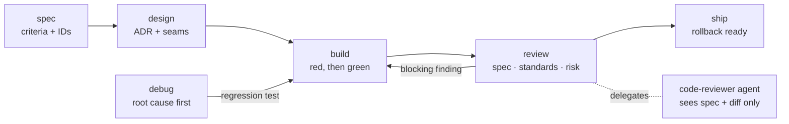

# Claude Fintech Skills

**IEEE-grounded software engineering and fintech-grade data discipline for
Claude Code, focused on value investing.**

This repository is a Claude Code plugin marketplace. Its plugin,
`value-analyst`, does two jobs:

1. **Builds value-investing software.** A software-engineering workflow
   (spec → design → test-first build → independent review → ship) based on
   the IEEE Computer Society's *Guide to the Software Engineering Body of
   Knowledge* (SWEBOK v4.0a), for .NET and Python applications.
2. **Does value-investing research.** An analyst that values companies the
   way an auditor would want: every number sourced and hash-chained in an
   evidence ledger, Decimal-only maths, cross-source reconciliation, forensic
   screens, and a second reviewer before any verdict.

Both halves follow the same fintech rules: money is never a float, data is
never invented or silently lost, and nothing is trusted without verification.

> Research and decision support only. The plugin never places trades and
> nothing it produces is personal financial advice.

---

## Contents

- [Why this exists](#why-this-exists)
- [Quick start](#quick-start)
- [Foundations](#foundations)
  - [IEEE SWEBOK v4](#ieee-swebok-v4)
  - [Fintech engineering practices](#fintech-engineering-practices)
- [Engineering workflow](#engineering-workflow)
- [Value-investing analyst](#value-investing-analyst)
- [Guardrails](#guardrails)
- [Configuration](#configuration)
- [Files the plugin creates in your project](#files-the-plugin-creates-in-your-project)
- [Testing and evaluation](#testing-and-evaluation)
- [Repository layout](#repository-layout)
- [Design choices](#design-choices)
- [Limitations](#limitations)
- [Contributing](#contributing)
- [Credits and licence](#credits-and-licence)

---

## Why this exists

General-purpose AI coding help is tuned for speed. Software that handles
money needs something else: traceable requirements, tests written before
code, explicit error handling, exact decimal arithmetic, audit trails, and a
second pair of eyes before anything is called done. Investment research has
the same shape of problem: a valuation built on one unverified,
wrongly-scaled or stale number looks just as confident as a correct one.

This plugin encodes those disciplines as short, plain instructions Claude
follows by default, enforced where it matters by scripts and hooks rather
than good intentions.

## Quick start

Install from GitHub inside Claude Code:

```
/plugin marketplace add asjad99/claude-fintech-skills
/plugin install value-analyst@fintech-skills
```

Or try it for one session from a local clone:

```bash
git clone https://github.com/asjad99/claude-fintech-skills.git
claude --plugin-dir ./claude-fintech-skills/plugins/value-analyst
```

Requirements: Claude Code, Python 3.10+ (standard library only, for the
analyst scripts), and git. For language diagnostics in your projects, also
install Anthropic's `csharp-lsp` and `pyright-lsp` plugins.

Then try:

| You type | What happens |
|---|---|
| `Add a margin-of-safety endpoint to our API` | `principles` and `build` load: a failing test first, decimal money, input contracts, then full checks |
| `/value-analyst:spec portfolio rebalancing` | Clarifying questions, then a spec with numbered, testable acceptance criteria |
| `The DCF result is wrong for MSFT` | `debug`: a reproducible failing check, root cause, regression test |
| `/value-analyst:review` | The `code-reviewer` agent checks the diff against the spec, standards and fintech risks |
| `/value-analyst:analyze AAPL` | Full value analysis with a sourced, reconciled, independently reviewed verdict |

---

## Foundations

### IEEE SWEBOK v4

The [SWEBOK Guide v4.0a](https://computer.org/swebok) (IEEE Computer Society)
organises generally accepted software-engineering knowledge into 18
knowledge areas. The plugin covers all 18 without creating 18 skills: areas
1-15 are practice and map to a workflow step; 16-18 are foundations the
model already has, so only the numeric rules that matter in finance are
written down.

| # | Knowledge area | What the agent does | Where |
|---|---|---|---|
| 1 | Requirements | User stories, numbered acceptance criteria, non-functional needs, traceability to tests | `spec` |
| 2 | Architecture | Records significant decisions with the concerns and options behind them | `design` |
| 3 | Design | Applies design principles; deep modules at clean seams; design rationale | `design` |
| 4 | Construction | Simple, readable code; contracts at boundaries; explicit error handling; test-first | `build` |
| 5 | Testing | Tests at agreed seams, independent expected values, boundary and property tests | `build`, `review` |
| 6 | Operations | Deployment, migrations, rollback, monitoring | `ship` |
| 7 | Maintenance | Program comprehension and impact analysis before change; root-cause fixes | `debug`, `build` |
| 8 | Configuration Management | Version control, locked dependencies, reproducible builds, releases | `ship`, `principles` |
| 9 | Engineering Management | Scope, risks, out-of-scope list | `spec` |
| 10 | Process | The workflow itself | all skills |
| 11 | Models and Methods | State machines, sequence diagrams, domain glossary | `design` |
| 12 | Quality | Reviews, quality attributes, evidence of done | `review` |
| 13 | Security | Input validation, least privilege, secrets, dependency scanning, STRIDE | `review`, `principles` |
| 14 | Professional Practice | Honest status, evidence, no overclaiming, no financial advice | `principles` |
| 15 | Economics | Options compared on effort, risk and cost to reverse | `design` |
| 16 | Computing Foundations | Already known to the model | — |
| 17 | Mathematical Foundations | Decimal arithmetic, rounding, precision | `fintech-rules.md` |
| 18 | Engineering Foundations | Measurement and root-cause analysis | `debug`, `review` |

From those areas come twelve principles that load on every coding task.
The wording is ours; each cites the SWEBOK section it rests on.

| # | Principle | SWEBOK source |
|---|---|---|
| P1 | **Trace.** Every change serves a requirement with an ID and acceptance criteria | Requirements 4.3, 7.3 |
| P2 | **Red first.** One failing test, then the code that passes it; vertical slices | Requirements 4.3; Construction 4.16 |
| P3 | **Simple.** The plainest code that meets the criterion | Construction 1.1 |
| P4 | **Deep modules.** Separate concerns, high cohesion, low coupling, small interfaces | Design 1.4 |
| P5 | **Verifiable.** Testable through public interfaces, structured logs, consistent conventions | Construction 1.3; Design 1.4 |
| P6 | **Contracts.** Preconditions at boundaries, validated inputs, every error handled explicitly | Construction 4.4, 4.5 |
| P7 | **Small steps.** Small, reversible changes; varying values in configuration | Construction 1.2 |
| P8 | **Impact first.** Read the code and its callers; state what else a change touches | Maintenance 2.1.3, 4.1 |
| P9 | **Record decisions.** Costly-to-reverse choices get an ADR with options weighed | Architecture 2.4; Design 4.6; Economics |
| P10 | **Secure by default.** Validate input, deny by default, least privilege, no secrets in code | Security 4 |
| P11 | **Reproducible.** Everything versioned, dependencies locked, schema changes as migrations | Configuration Management |
| P12 | **Evidence.** Done means shown command output; untested and unknown things are named | Professional Practice; Testing 1.2 |

### Fintech engineering practices

The money and data rules come from the
[Fintech Engineering Handbook](https://handbook.fintechengineer.io), which
builds on Voytek Pitula's Fintech Engineering Handbook (CC BY 4.0). Its three
tenets, restated for both writing software and doing research:

| Tenet | In application code | In research |
|---|---|---|
| **No invented data** | Every balance or figure is derivable from recorded entries | Every number in a report cites a ledger entry; missing data is reported as unavailable |
| **No lost data** | Raw inputs stored before transformation; corrections are new records | Raw filings and API responses saved by SHA-256; the ledger is append-only |
| **No trust** | Validate at every boundary; reconcile with independent sources; fail loudly | Cross-check vendors against filings; stale prices refused; a second reviewer signs off |

The rules Claude applies to code (full list in
`plugins/value-analyst/references/fintech-rules.md`):

- **Money:** a decimal type everywhere (`decimal` in C#, `decimal.Decimal` in
  Python); amount and currency travel together; no cross-currency arithmetic;
  ISO 4217 minor units; round once, at a boundary, with the mode stated;
  allocations track the residual; money crosses JSON as a string.
- **FX and prices:** rates are directional, dated and sourced; prices past a
  staleness limit are shown as unavailable.
- **Securities:** identify by ISIN, CUSIP or FIGI, never ticker alone; apply
  corporate actions as recorded events; trade date and settlement date are
  separate.
- **External data:** validate fields you use, store raw responses, reconcile
  against a second source, treat webhooks and news as hints.
- **Writes and audit:** idempotency keys on retryable writes; append-only
  records with compensating corrections; audit answers what, when, who and
  why, without personal data.
- **Time:** store UTC, compare market dates in the exchange's local date,
  inject the clock.
- **Tests:** property tests for money maths, golden tests for valuations,
  invariants checked after every step.

---

## Engineering workflow



Small changes go straight to `build` and `review` with a one-line acceptance
criterion. `spec` and `design` are for new features and changes that cross
modules, the data model, a public API or a data source.

| Skill | Use when | Done when |
|---|---|---|
| `principles` | Any coding task (loads automatically) | — |
| `/value-analyst:spec` | New feature or vague request | Approved spec in `docs/specs/` with numbered, testable acceptance criteria |
| `/value-analyst:design` | Change crosses modules, data model, API or data source | ADR in `docs/adr/`, glossary updated, test seams agreed |
| `/value-analyst:build` | Writing or changing code | Every criterion has a test that went red then green; full checks shown passing |
| `/value-analyst:debug` | Bug, wrong number, flaky test, slowdown | Root cause stated; regression test red before the fix, green after |
| `/value-analyst:review` | Before calling work done | The `code-reviewer` agent reports no blocking findings |
| `/value-analyst:ship` | Merge, release, deploy | Version, changelog, migrations, rollback steps and monitoring evidenced |

**The independent reviewer.** `review` hands the `code-reviewer` agent only
the base branch, the spec and the check commands, never the builder's
reasoning, so the work is not graded by its author. The agent checks three
axes and returns blocking, should-fix and note findings with `file:line`:

- **Spec:** every criterion implemented and covered by a test that would fail
  without it; nothing out of scope added.
- **Standards:** the repo's documented standards first, then a code-smell
  baseline, silent failures (empty or broad catches, hidden fallbacks), and
  weak tests (tautological assertions, tests coupled to internals).
- **Risk:** security (injection, authorisation, secrets, vulnerable
  dependencies, a STRIDE pass on new endpoints), the fintech rules above,
  migration safety, and any code that would place orders or give advice.

**Language-agnostic by design.** Versions, frameworks, test runners and
commands are read from the repository (`global.json`, `*.csproj`,
`Directory.Build.props`, `pyproject.toml`, lock files, CI workflows). Short
notes for each language cover what is easy to get wrong in finance:

- **.NET** (`references/dotnet.md`): `decimal` and a `Money` value type,
  explicit `MidpointRounding`, money as strings in System.Text.Json,
  `DateOnly` and `TimeProvider`, EF Core decimal precision, nullable and
  analyzers as errors, xUnit with string-parsed decimal cases, FsCheck,
  Testcontainers, Verify.
- **Python** (`references/python.md`): `Decimal` from strings with explicit
  quantize, frozen `Money` dataclass, timezone-aware datetimes, strict type
  checking, ruff, pytest with Hypothesis, `pip-audit`.

---

## Value-investing analyst

The research side follows a classic value method (circle of competence →
business quality → financial strength → earnings quality → normalised
earnings → triangulated valuation → margin of safety → falsifiable thesis),
on top of an evidence ledger.

| Command | What it does |
|---|---|
| `/value-analyst:analyze <ticker>` | The full pipeline below, ending in a reviewed verdict |
| `/value-analyst:gather-evidence <KEY>` | Pulls statements, prices and corporate actions into the ledger with raw payloads |
| `/value-analyst:reconcile-data <KEY>` | Cross-source and accounting-identity checks; classifies and resolves breaks |
| `/value-analyst:forensic-quality <KEY>` | ROIC, margins, FCF conversion, leverage, Piotroski F, Altman Z, Beneish M |
| `/value-analyst:valuation <KEY>` | EPV, DCF, reverse DCF, NCAV, owner earnings, Graham number, margin of safety |
| `/value-analyst:review-thesis <KEY>` | The `thesis-checker` agent re-derives key inputs from raw sources and approves or rejects |
| `/value-analyst:portfolio-review lots.csv` | Holdings vs intrinsic value, stale prices, sell plans with lot selection and wash-sale flags |
| `/value-analyst:dossier <KEY>` | Audit trail: how a conclusion was reached |

`data-discipline` loads automatically whenever Claude states or computes a
financial figure, even in a quick answer.

**How a number earns its place.**

1. A filing or API response is saved verbatim (`ledger.py raw`) and gets an
   `R-` id with its SHA-256.
2. Each figure read from it becomes a fact (`F-` id) with source tier
   (primary filing, secondary vendor, tertiary news), period, scale and
   locator.
3. Judgements become assumptions (`A-` ids) with a rationale and range.
4. Calculators accept ledger ids only, never typed numbers, and record
   computations (`C-` ids) listing every input.
5. Reconciliation runs (`K-` ids) compare sources and statement identities
   (assets = liabilities + equity), classifying scale, sign, period,
   currency, restatement and genuine breaks.
6. A verdict (`D-` id: CANDIDATE, WATCHLIST, PASS or INSUFFICIENT_DATA) is
   proposed by the analyst and approved or rejected (`V-` id) by a different
   actor; the ledger refuses self-approval.
7. Every report line that states a number must cite its ids, such as
   `[F-0012]` or `[C-0007]`.

Each ledger entry hashes the one before it, so `ledger.py verify` detects any
edit. Corrections never overwrite; they supersede with a reason.

---

## Guardrails

Instructions guide; these enforce.

| Guardrail | Type | What it stops |
|---|---|---|
| Ledger guard | PreToolUse hook | Direct edits, deletes or shell redirects into `ledger.jsonl` or raw payloads |
| Provenance lint | PostToolUse hook | Report lines with numbers but no ledger citation, or citing superseded entries |
| Ids-only calculators | Script design | Valuation inputs that were never sourced or recorded |
| Maker-checker | Ledger rule and agents | A verdict or code change approved by its own author |
| Staleness limits | Configuration | Valuing on old prices or fundamentals |
| Decimal-only maths | `money.py` | Floats, unknown currencies, cross-currency arithmetic |

---

## Configuration

Set when installing, or later with
`/plugin configure value-analyst@fintech-skills`:

| Option | Default | Meaning |
|---|---|---|
| `research_dir` | `research` | Folder holding one ledger per security |
| `base_currency` | `USD` | Portfolio reporting currency |
| `required_margin_of_safety_pct` | `30` | Minimum margin of safety for a CANDIDATE verdict |
| `max_price_age_days` | `3` | Older prices are treated as unavailable |
| `max_fundamentals_age_days` | `120` | Staleness limit for interim data (annual data gets an extra year) |

## Files the plugin creates in your project

Created only when there is something to write:

| Path | Created by | Contents |
|---|---|---|
| `docs/specs/<feature>.md` | `spec` | Problem, stories, acceptance criteria, non-functional needs, risks |
| `docs/adr/NNNN-<title>.md` | `design` | Context, options, decision, consequences (append-only) |
| `GLOSSARY.md` | `design` | Domain terms such as intrinsic value, tax lot, corporate action |
| `research/<KEY>/ledger.jsonl` | analyst skills | Hash-chained evidence ledger |
| `research/<KEY>/raw/` | analyst skills | Source payloads named by SHA-256 |
| `research/<KEY>/report.md` | `analyze` | Report with every figure cited |

Specs and ADRs are plain Markdown so they can move into an issue tracker
later without changes.

---

## Testing and evaluation

**Unit tests** for the analyst scripts (standard library only):

```bash
cd plugins/value-analyst
python3 -m unittest discover -s tests -v
```

27 tests cover money properties, ledger tamper detection, maker-checker,
golden DCF values, reverse DCF, reconciliation classification, split
adjustment, staleness, the hooks and wash-sale detection.

**Prompt evaluations** check that the instructions change Claude's
behaviour. Each case runs with and without the plugin:

```bash
claude plugin eval plugins/value-analyst --scaffold --allow-tools Write Edit
```

Latest run (2 runs per arm, October 2026):

| Case | With plugin | Without | What it checks |
|---|---|---|---|
| C# margin-of-safety calculator | 1.00 | 0.63 | decimal money, tests before code, input contracts, honest report |
| Python dividend split off by a cent | 1.00 | 0.67 | root cause named, residual handled, regression test |
| Vague "add rebalancing" request | 1.00 | 0.75 | clarifying questions before code |
| Review with two planted defects | 1.00 | 1.00 | swallowed exception and float price both found |

The review case is already solved without the plugin, so it needs subtler
planted defects to measure the reviewer's contribution.

---

## Repository layout

```
.claude-plugin/marketplace.json        marketplace definition
plugins/value-analyst/
├── .claude-plugin/plugin.json         manifest and user configuration
├── skills/
│   ├── principles, spec, design, build, debug, review, ship      engineering
│   └── analyze, gather-evidence, reconcile-data, forensic-quality,
│       valuation, review-thesis, portfolio-review, dossier,
│       data-discipline                                           research
├── agents/                            code-reviewer, thesis-checker, evidence-collector
├── hooks/hooks.json                   ledger guard, provenance lint
├── scripts/                           money, ledger, valuation, forensics,
│                                      reconcile, corpactions, portfolio, hooks
├── references/                        fintech rules, .NET and Python notes,
│                                      value method, metrics, data sources,
│                                      handbook mapping, report and CSV formats
├── tests/                             unit tests
└── evals/                             prompt evaluation cases
```

## Design choices

- **Few, short skills.** Seven engineering skills of 230-500 words each, not
  one per knowledge area. Each step ends on a checkable "done when".
- **Rules that matter are enforced in code.** Hooks and scripts carry the
  invariants; prose carries judgement.
- **The repository is the source of truth** for versions, frameworks and
  commands, so the plugin doesn't go stale when a project upgrades.
- **Maker-checker everywhere.** Code and verdicts are both reviewed by an
  agent that never saw the author's reasoning.
- **Left out on purpose:** framework tutorials the model already knows,
  payment rails, lending, crypto, KYC/AML and anything that places orders.

## Limitations

- The provenance linter is a heuristic. It catches untagged figures, not a
  tagged sentence that misstates its source; that is the reviewer's job.
- Forensic scores (Altman, Beneish, Piotroski) are screens fitted to specific
  samples, not verdicts, and do not apply to banks and insurers.
- Wash-sale logic implements the US 30-day rule as a warning only.
- Evaluations are small (four cases); treat them as smoke tests, not proof.
- Instructions improve consistency; they don't replace human review of code
  or investment decisions.

## Contributing

Contributions are welcome. Keep the house style:

- Every new rule cites its SWEBOK section or handbook chapter.
- State the behaviour you want; save prohibitions for hard guardrails.
- End each step with a checkable "done when".
- Keep skills under about 600 words; move reference material into
  `references/` behind a pointer.
- Add or update an eval case for any behaviour change, and run
  `claude plugin validate --strict plugins/value-analyst` and the unit tests.

## Credits and licence

MIT licence.

- **SWEBOK Guide v4.0a**, IEEE Computer Society: source of the engineering
  principles. Cited, not reproduced.
- **Fintech Engineering Handbook** (handbook.fintechengineer.io), after
  Voytek Pitula (CC BY 4.0): source of the fintech tenets. Paraphrased, not
  reproduced; the site carries a `noai` robots tag, so check its licence
  before redistributing derived material.
- Workflows adapted, rewritten and credited from MIT- and Apache-licensed
  projects: [obra/superpowers](https://github.com/obra/superpowers),
  [mattpocock/skills](https://github.com/mattpocock/skills),
  [anthropics/claude-plugins-official](https://github.com/anthropics/claude-plugins-official),
  [garrytan/gstack](https://github.com/garrytan/gstack) and
  [Aaronontheweb/dotnet-skills](https://github.com/Aaronontheweb/dotnet-skills).

Research and decision support only. Not personal financial advice.
